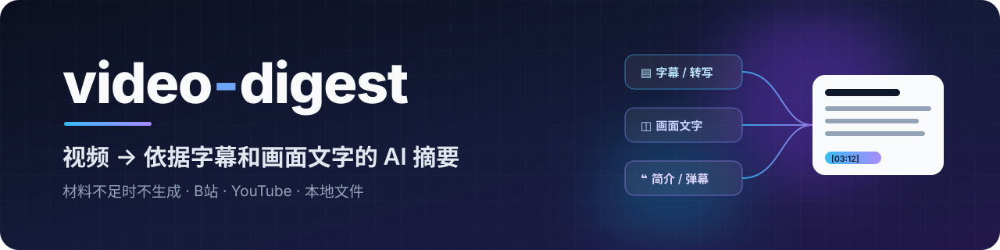
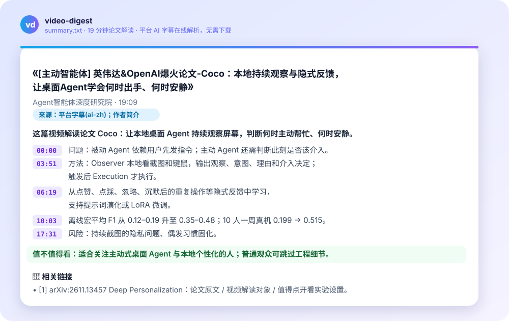
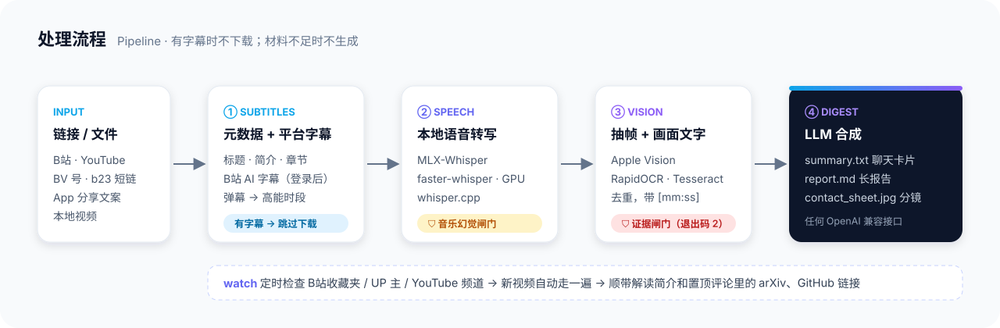

<div align="center">



<p>
  <a href="https://github.com/tdsmonster/video-digest/actions/workflows/ci.yml"></a>
  <a href="https://github.com/tdsmonster/video-digest/releases"></a>
  
  
  <a href="LICENSE"></a>
</p>

**发一个视频链接，拿回一张带时间戳的摘要卡片：每一条都有出处，没有证据就不写。**

[快速开始](#-快速开始) · [用法](#-用法) · [订阅追更](#-订阅追更) · [配置](#-配置) · [English](README_EN.md)

</div>

<br>

<p align="center">
  
</p>

<p align="center"><sub>真实输出示例：19 分钟的 B站 论文解读，用平台 AI 字幕在线解析，不需要下载视频。</sub></p>

## ✨ 亮点

<table>
<tr>
<td width="50%" valign="top">

### 🧾 没证据就不写
没有可靠台词、画面文字、简介或弹幕时直接失败（退出码 `2`），不会只凭标题写出一篇像模像样的"摘要"。

</td>
<td width="50%" valign="top">

### 🎵 识别 Whisper 幻觉
音乐和静音段落里"听出来"的「作曲 李宗盛」「谢谢观看」「oh oh oh」，会按文字密度、重复次数和固定短语过滤掉。

</td>
</tr>
<tr>
<td valign="top">

### 🖼️ 也看画面
均匀抽帧做 OCR 并去重，PPT、代码、报错、屏幕上的网址都会成为带 `[mm:ss]` 的证据。

</td>
<td valign="top">

### ⚡ 能不下载就不下载
有平台字幕（包括登录后的 B站 AI 字幕）时直接在线解析，44 分钟的讲座约 50 秒出结果。

</td>
</tr>
<tr>
<td valign="top">

### 📺 B站 细节都处理了
HTTP 567、b23 短链、App 分享文案、分 P、AI 字幕、弹幕高能时段（只作为"观众反应"，不当视频内容）。

</td>
<td valign="top">

### 📡 订阅追更
定时检查 B站收藏夹、UP 主或 YouTube 频道，新视频自动出摘要，并顺着简介和置顶评论去读 arXiv 论文和 GitHub 仓库。

</td>
</tr>
</table>

## 🔍 工作原理

<p align="center">
  
</p>

每个视频输出一个目录：

| 文件 | 内容 |
|---|---|
| `summary.txt` | 纯文本卡片，可直接发到 Telegram、微信等：一句话概括、3–5 条带时间戳的要点、值不值得看 |
| `report.md` | 按时间顺序的长报告：关键数据、画面文字补充了什么、哪些地方证据不足 |
| `contact_sheet.jpg` | 4×4 分镜图 |
| `transcript.srt` · `ocr.txt` · `result.json` | 原始证据和结构化结果 |

## 🚀 快速开始

**1. 安装 ffmpeg**

```bash
brew install ffmpeg            # macOS
sudo apt install ffmpeg        # Ubuntu / Debian
winget install Gyan.FFmpeg     # Windows
```

**2. 安装 video-digest**（推荐 [uv](https://docs.astral.sh/uv/)，也可以用 pipx）

```bash
uv tool install "video-digest[all] @ git+https://github.com/tdsmonster/video-digest"
```

`[all]` 会按平台挑选后端：Apple Silicon 用 MLX-Whisper + Apple Vision，其他平台用 faster-whisper + RapidOCR。

**3. 配置 API key 并自检**

```bash
export VIDEO_DIGEST_API_KEY=sk-...      # PowerShell: $env:VIDEO_DIGEST_API_KEY="sk-..."
video-digest doctor --ping
```

默认用 DeepSeek，也可以换成任何 OpenAI 兼容接口，包括本地 Ollama（不需要 key），见[配置](#-配置)。

<details>
<summary>按需单独安装某个后端</summary>

| extra | 内容 | 适合 |
|---|---|---|
| `[mlx]` | MLX-Whisper | Apple Silicon |
| `[whisper]` | faster-whisper（有 NVIDIA 显卡自动用 CUDA，运行库缺失时自动退回 CPU） | Linux / Windows / Intel Mac |
| `[ocr]` | RapidOCR | Linux / Windows |
| `[bili]` | 在终端显示 B站 登录二维码 | 所有平台 |

macOS 首次使用 Apple Vision OCR 时会自动编译一个小工具，需要 Xcode Command Line Tools（`xcode-select --install`）。

</details>

## 🧭 用法

```bash
video-digest https://www.bilibili.com/video/BV1xx411c7mD
video-digest BV1xx411c7mD                       # 直接写 BV 号
video-digest "【标题】 https://b23.tv/xxxx"       # App 分享文案原样粘贴
video-digest https://youtu.be/xxxx --language en  # 英文摘要
video-digest ./lecture.mp4                      # 本地文件
video-digest <链接> --json                       # 给脚本 / 机器人用
```

| `--mode` | 行为 |
|---|---|
| `auto`（默认） | 有平台字幕就在线解析，没有再下载 |
| `online` | 只用字幕、简介、弹幕，绝不下载 |
| `download` | 一定下载，做语音转写和画面文字识别 |

退出码：`0` 成功 · `1` 视频不可用 · `2` 证据不足 · `3` LLM 失败（已写降级报告）

<details>
<summary>清晰度：为什么需要下载时默认 1080p</summary>

画面文字识别对清晰度很敏感。我们在一个 5 分钟的录屏教程上，在 24 个相同时间点抽帧做识别，以 1080p 的结果为准：

| 分辨率 | 文字行识别率 | 下载量 |
|---|---|---|
| 480p | 79%（小字界面、价格整块漏掉） | 1× |
| 720p | 88% | 约 1.8× |
| 1080p | 100% | 约 3.8× |

大标题和字幕条在 480p 下也基本能认对，丢掉的主要是小字。语音转写不受影响，因为音轨总是单独取最佳音质。有平台字幕时 `auto` 模式根本不下载视频，所以这个设置只影响需要下载的情况。下载时会在上限内自动挑最高的可用画质（源只有 720p 就用 720p；竖屏视频按短边算）。想省流量可以用 `--max-height 720` 或在配置里设 `[video] max_height = 720`。

</details>

### B站 登录（可选）

登录后能拿到 B站 AI 字幕（大多数视频因此不用下载），也能读私密收藏夹。cookie 只保存在本机，权限 600。

```bash
video-digest bili-login          # 终端显示二维码，用 B站 App 扫码
video-digest bili-login --check
```

## 📡 订阅追更

在配置文件里加入来源（完整示例见 [config.example.toml](config.example.toml)）：

```toml
[[watch.sources]]
type = "bili_fav"                # B站收藏夹；还支持 bili_up（UP 主）
id = 1234567890
label = "收藏夹 · AI"

[[watch.sources]]
type = "ytdlp"                   # 任何 yt-dlp 支持的频道 / 播放列表
url = "https://www.youtube.com/@SomeChannel/videos"
label = "YouTube · SomeChannel"
```

```bash
video-digest watch --init        # 第一次：把现有视频登记为基线，不解析
video-digest watch               # 之后定时跑：只处理新视频；没有新内容时 stdout 为空
```

stdout 是一份汇总，适合交给定时任务转发到 Telegram 或邮件；每个视频的完整报告写在 `watch.output_dir`。

<details>
<summary>定时任务示例</summary>

```bash
# Linux / macOS crontab：每天 10:00 和 18:00
0 10,18 * * * /path/to/video-digest watch >> ~/video-digest-watch.log 2>&1
```

```powershell
# Windows 任务计划程序
schtasks /Create /SC DAILY /ST 10:00 /TN video-digest-watch /TR "video-digest watch"
```

</details>

## 🔧 配置

`video-digest config-path` 会显示配置文件位置（macOS / Linux 是 `~/.config/video-digest/config.toml`，Windows 是 `%APPDATA%\video-digest\config.toml`）。复制 [config.example.toml](config.example.toml) 过去改就行。所有项都可以省略。

| 想要 | 怎么配 |
|---|---|
| 用 OpenAI | `[llm]` `base_url = "https://api.openai.com/v1"` · `model = "gpt-4.1-mini"` |
| 用本地 Ollama | `[llm]` `base_url = "http://localhost:11434/v1"` · `model = "qwen3:14b"` |
| 英文摘要 | `[output]` `language = "en"`，或命令行 `--language en` |
| 指定转写后端 | `[asr]` `backend = "faster-whisper"` · `device = "cuda"` |
| 用 whisper.cpp | `[asr]` `backend = "whisper-cpp"` · `whisper_cpp_model = "/path/ggml-large-v3-turbo.bin"` |

<details>
<summary>环境变量</summary>

`VIDEO_DIGEST_API_KEY` · `VIDEO_DIGEST_BASE_URL` · `VIDEO_DIGEST_MODEL` · `VIDEO_DIGEST_ASR` · `VIDEO_DIGEST_OCR` · `VIDEO_DIGEST_OUTPUT` · `VIDEO_DIGEST_LANGUAGE` · `VIDEO_DIGEST_CONFIG`

API key 也会读取 `DEEPSEEK_API_KEY` / `OPENAI_API_KEY`。

</details>

## 🖥️ 平台支持

| 平台 | 语音转写 | 画面文字 |
|---|---|---|
| 🍎 macOS · Apple Silicon | MLX-Whisper large-v3-turbo | Apple Vision（系统自带） |
| 🍎 macOS · Intel | faster-whisper（CPU） | Apple Vision |
| 🐧 Linux / 🪟 Windows + NVIDIA | faster-whisper large-v3-turbo（CUDA） | RapidOCR |
| 🐧 Linux / 🪟 Windows · 仅 CPU | faster-whisper small（int8） | RapidOCR |

在 macOS、Linux（Docker）和 Windows 笔记本上都实际跑通过；CI 在三个平台上跑测试。一个后端都没装也能用：有平台字幕的视频照样能出摘要，只是没有字幕时没法转写。

## 🔒 隐私

- 视频、音频、截图都在本地处理，用完即删。
- 发给 LLM 的只有文字：字幕或转写、画面文字、标题、简介、弹幕统计。
- `watch` 解读链接时会访问 arXiv、GitHub API 和 [Jina Reader](https://jina.ai/reader)（抓普通网页正文）。不需要的话设 `fetch_links = false`。

## 🛠️ 开发

```bash
git clone https://github.com/tdsmonster/video-digest && cd video-digest
uv venv && uv pip install -e ".[dev,all]"
pytest
```

欢迎提 Issue 和 PR。

## 📄 License

[MIT](LICENSE)
