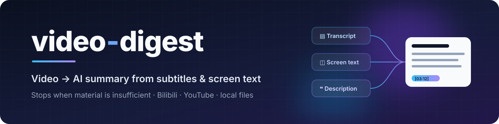
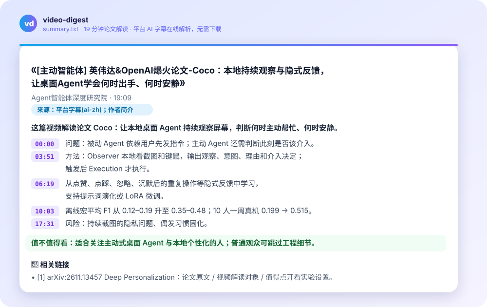
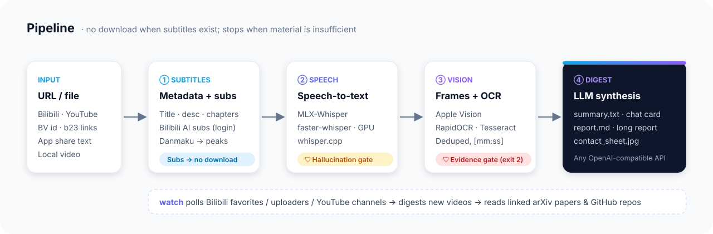

<div align="center">



<p>
  <a href="https://github.com/tdsmonster/video-digest/actions/workflows/ci.yml"></a>
  <a href="https://github.com/tdsmonster/video-digest/releases"></a>
  
  
  <a href="LICENSE"></a>
</p>

**Give it a video link and get a timestamped summary, generated from subtitles, speech transcripts, on-screen text and the description. If there is too little material, it exits with an error instead of generating one.**

<sub>Summaries are generated by an LLM and can still be wrong. Check the video for anything important.</sub>

[Quick start](#-quick-start) · [Usage](#-usage) · [Watch](#-watch-subscriptions) · [Configuration](#-configuration) · [中文](README.md)

</div>

<br>

<p align="center">
  
</p>

<p align="center"><sub>Real output (Chinese, the default language; set <code>--language en</code> for English). A 19-minute Bilibili paper walkthrough summarized from its AI subtitles, with no download.</sub></p>

## ✨ Highlights

<table>
<tr>
<td width="50%" valign="top">

### 🧾 Stops when material is insufficient
If there is no usable speech, on-screen text, description or danmaku, it exits with code `2` rather than summarizing from the title alone.

</td>
<td width="50%" valign="top">

### 🎵 Filters common transcription hallucinations
Over music and silence, Whisper often outputs lyric credits, "thanks for watching" or "oh oh oh". Rule-based checks on text density, repetition and known phrases catch the common cases, but not every case.

</td>
</tr>
<tr>
<td valign="top">

### 🖼️ Reads on-screen text
Frames are sampled, OCR'd and de-duplicated, so text from slides, code, error messages and on-screen URLs can be cited with `[mm:ss]`. Small-text accuracy depends on resolution (see below).

</td>
<td valign="top">

### ⚡ No download when subtitles exist
With platform subtitles (including Bilibili AI subtitles after login) it works from the subtitles. One 44-minute lecture we tested took about 50 seconds; actual speed depends on network and model.

</td>
</tr>
<tr>
<td valign="top">

### 📺 Bilibili support
Handles HTTP 567, b23.tv short links, app share text, multi-part videos and AI subtitles. Danmaku peaks are passed to the LLM as audience reaction, not as video content.

</td>
<td valign="top">

### 📡 Watch subscriptions
Polls Bilibili favorites, uploaders or YouTube channels and summarizes new videos. For arXiv, GitHub and GitLab links in the description, pinned comment or on screen, it fetches the abstract or repository README. Each link is tagged with where it came from; URLs read from the screen by OCR may contain typos and are marked as such.

</td>
</tr>
</table>

## 🔍 How it works

<p align="center">
  
</p>

Each video gets its own output directory:

| File | Contents |
|---|---|
| `summary.txt` | Plain-text card for Telegram, Slack and similar apps: a one-line gist, 3–5 timestamped points and a "worth watching?" verdict |
| `report.md` | Chronological long-form report: key facts, what the on-screen text added and where the evidence is weak |
| `contact_sheet.jpg` | 4×4 storyboard |
| `transcript.srt` · `ocr.txt` · `result.json` | Raw evidence and structured results |

## 🚀 Quick start

**1. Install ffmpeg**

```bash
brew install ffmpeg            # macOS
sudo apt install ffmpeg        # Ubuntu / Debian
winget install Gyan.FFmpeg     # Windows
```

**2. Install video-digest** ([uv](https://docs.astral.sh/uv/) recommended; pipx works too)

```bash
uv tool install "video-digest[all] @ git+https://github.com/tdsmonster/video-digest"
```

`[all]` picks backends for your platform: MLX-Whisper + Apple Vision on Apple Silicon, faster-whisper + RapidOCR elsewhere.

**3. Set an API key and check your setup**

```bash
export VIDEO_DIGEST_API_KEY=sk-...      # PowerShell: $env:VIDEO_DIGEST_API_KEY="sk-..."
video-digest doctor --ping
```

DeepSeek is the default, but any OpenAI-compatible endpoint works, including a local Ollama with no key. See [Configuration](#-configuration).

<details>
<summary>Installing individual backends</summary>

| extra | What it installs | For |
|---|---|---|
| `[mlx]` | MLX-Whisper | Apple Silicon |
| `[whisper]` | faster-whisper (uses CUDA on NVIDIA GPUs, falls back to CPU if the CUDA runtime is missing) | Linux / Windows / Intel Mac |
| `[ocr]` | RapidOCR | Linux / Windows |
| `[bili]` | Shows the Bilibili login QR code in the terminal | Any platform |

On macOS the Apple Vision OCR helper is compiled on first use. This needs the Xcode Command Line Tools (`xcode-select --install`).

</details>

## 🧭 Usage

```bash
video-digest https://www.youtube.com/watch?v=xxxx --language en
video-digest BV1xx411c7mD                       # Bilibili id
video-digest "【标题】 https://b23.tv/xxxx"       # app share text, pasted as is
video-digest ./lecture.mp4                      # local file
video-digest <url> --json                       # for scripts and bots
```

| `--mode` | Behavior |
|---|---|
| `auto` (default) | Use platform subtitles online if available, otherwise download |
| `online` | Subtitles, description and danmaku only; no download |
| `download` | Always downloads, transcribes and runs OCR |

Exit codes: `0` ok · `1` unavailable · `2` insufficient evidence · `3` LLM failure (a fallback report is still written)

<details>
<summary>Resolution: why downloads default to 1080p</summary>

On-screen text recognition depends on resolution. On one 5-minute screen-recording tutorial (24 identical frames, using the text recognized at 1080p as the baseline), 480p recovered about 79% of those lines and 720p about 88%, at roughly 1× / 1.8× / 3.8× the download size of 480p / 720p / 1080p. This is a single test, so treat the numbers as indicative. Large titles were mostly readable at 480p; small UI text and prices were not. Speech recognition is unaffected because audio always uses the best stream. `auto` mode skips the download when subtitles exist. Downloads pick the highest available quality up to the cap (a 720p-only source gives 720p; vertical videos count the short side). To save bandwidth, use `--max-height 720` or set `[video] max_height = 720`.

</details>

`video-digest bili-login` logs in to Bilibili by QR code, which unlocks AI subtitles and private favorites. The cookie stays local with mode 600.

## 📡 Watch subscriptions

Add sources to your config (see [config.example.toml](config.example.toml)):

```toml
[[watch.sources]]
type = "ytdlp"                   # any channel / playlist yt-dlp supports
url = "https://www.youtube.com/@SomeChannel/videos"
label = "YouTube · SomeChannel"

[[watch.sources]]
type = "bili_fav"                # Bilibili favorites; bili_up for uploaders
id = 1234567890
label = "Favorites · AI"
```

```bash
video-digest watch --init        # first run: record existing videos as baseline
video-digest watch               # run from cron / Task Scheduler
```

stdout is a digest you can forward to Telegram or email. It stays empty when there is nothing new. Full per-video reports go to `watch.output_dir`.

## 🔧 Configuration

`video-digest config-path` shows where the config file lives (`~/.config/video-digest/config.toml`, or `%APPDATA%\video-digest\config.toml` on Windows). Every key is optional.

| Goal | Setting |
|---|---|
| OpenAI | `[llm]` `base_url = "https://api.openai.com/v1"` · `model = "gpt-4.1-mini"` |
| Local Ollama | `[llm]` `base_url = "http://localhost:11434/v1"` · `model = "qwen3:14b"` |
| English output | `[output]` `language = "en"` or `--language en` |
| Specific ASR backend | `[asr]` `backend = "faster-whisper"` · `device = "cuda"` |
| whisper.cpp | `[asr]` `backend = "whisper-cpp"` · `whisper_cpp_model = "/path/ggml-large-v3-turbo.bin"` |

Environment variables: `VIDEO_DIGEST_API_KEY`, `VIDEO_DIGEST_BASE_URL`, `VIDEO_DIGEST_MODEL`, `VIDEO_DIGEST_ASR`, `VIDEO_DIGEST_OCR`, `VIDEO_DIGEST_OUTPUT`, `VIDEO_DIGEST_LANGUAGE`, `VIDEO_DIGEST_CONFIG`.

## 🖥️ Platforms

| Platform | Speech-to-text | On-screen text |
|---|---|---|
| 🍎 macOS · Apple Silicon | MLX-Whisper large-v3-turbo | Apple Vision (built in) |
| 🍎 macOS · Intel | faster-whisper (CPU) | Apple Vision |
| 🐧 Linux / 🪟 Windows + NVIDIA | faster-whisper large-v3-turbo (CUDA) | RapidOCR |
| 🐧 Linux / 🪟 Windows · CPU only | faster-whisper small (int8) | RapidOCR |

Tested on macOS, Linux (Docker) and a real Windows laptop; CI runs on all three. With no backends installed, videos that have platform subtitles still work.

## 🔒 Privacy

- Media is processed locally and deleted afterwards.
- Only text (transcript, OCR text, title, description, danmaku stats) is sent to the LLM.
- `watch` link enrichment calls arXiv, the GitHub API, the GitLab API and [Jina Reader](https://jina.ai/reader). Set `fetch_links = false` to turn this off.

## 🛠️ Development

```bash
git clone https://github.com/tdsmonster/video-digest && cd video-digest
uv venv && uv pip install -e ".[dev,all]"
pytest
```

Issues and PRs are welcome.

## 📄 License

[MIT](LICENSE)
