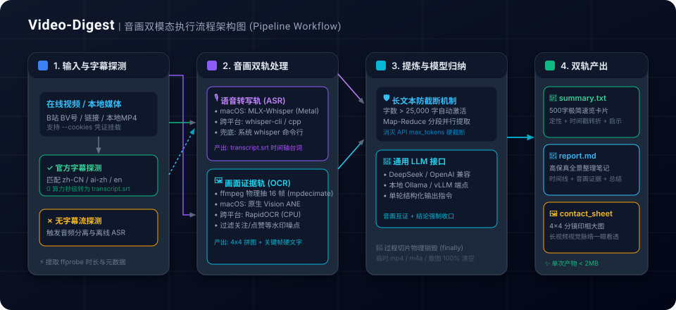

<div align="center">

# 🎬 Video-Digest

**Lightweight Video Summarizer & Visual Note-Taking CLI**

*A lightweight video summarizer CLI that combines audio transcripts with visual OCR.*

[](https://opensource.org/licenses/MIT)
[](https://www.python.org/)
[](https://github.com/tdsmonster/video-digest)

<p align="center">
  <a href="#-key-features">Key Features</a> •
  <a href="#-pipeline-workflow">Workflow</a> •
  <a href="#-quick-start">Quick Start</a> •
  <a href="#-usage-examples">Usage</a> •
  <a href="#-output-artifacts">Outputs</a> •
  <a href="README.md">中文文档</a>
</p>

---

</div>

When watching lectures, coding tutorials, or technical presentations, summarizing text subtitles alone often misses crucial visual context (e.g., code snippets, error messages, slides, and benchmark charts). 

`Video-Digest` extracts subtitles and audio while simultaneously capturing keyframes and performing local OCR, producing a comprehensive, verifiable summary report.

---

## 🗺️ Pipeline Workflow

```
 ┌──────────────────┐       ┌────────────────────────┐       ┌────────────────────────┐       ┌──────────────────────┐
 │ 1. Input & Subs  │  ──►  │ 2. Dual-Track Extract  │  ──►  │ 3. LLM Synthesis       │  ──►  │ 4. Output Delivery   │
 │ • URL / Local    │       │ • Audio: MLX / Whisper │       │ • Map-Reduce Guard     │       │ • summary.txt (Card) │
 │ • Official First │       │ • Video: ANE / OCR     │       │ • Standard OpenAI / DS │       │ • report.md (Notes)  │
 └──────────────────┘       └────────────────────────┘       └────────────────────────┘       └──────────────────────┘
```

<div align="center">
  
</div>

---

## ✨ Key Features

1. **Audio-Visual Grounding**
   - **Transcript First**: Extracts native subtitles in seconds. Falls back to offline Whisper (e.g., Apple Silicon MLX-Whisper or whisper.cpp) if no subtitles are available.
   - **Visual Evidence**: Extracts key visual frames using ffmpeg `mpdecimate`, runs local OCR (macOS Vision ANE or RapidOCR on CPU), and tiles a 4×4 contact sheet for quick inspection.

2. **Lightweight & Clean Architecture**
   - Core CLI is built purely with Python standard libraries—zero heavy forced dependencies.
   - Temporary video/audio slices are purged in `finally` blocks, keeping long-term disk usage `< 2MB`.

3. **Standard LLM Compatibility**
   - Works with any OpenAI-compatible API (DeepSeek, OpenAI, local Ollama, vLLM, etc.) via standard environment variables or flags.

---

## 🛠️ Requirements

- **Python**: 3.9+
- **System Tools**:
  - `ffmpeg`: `brew install ffmpeg` or `apt install ffmpeg`
  - `yt-dlp`: `pip install yt-dlp`
- **Optional Dependencies**:
  - macOS users: `pip install mlx-whisper` for fast local speech transcription.
  - Linux/Windows users: `pip install rapidocr-onnxruntime` for CPU OCR.

---

## 🚀 Quick Start

### 1. Installation

```bash
git clone https://github.com/tdsmonster/video-digest.git
cd video-digest
pip install -e .
```

### 2. Configure API Key

```bash
# Recommended: DeepSeek
export DEEPSEEK_API_KEY="your-api-key"

# Or standard OpenAI
export OPENAI_API_KEY="your-api-key"
export OPENAI_BASE_URL="https://api.openai.com/v1"
```

---

## 💡 Usage Examples

### 1. Summarize Online Video or Bilibili

```bash
# Provide URL or Bilibili BV ID
video-digest "https://www.bilibili.com/video/BV1xx411c7mD"

# Custom output directory
video-digest "BV1xx411c7mD" -o ./my_notes
```

### 2. Summarize Local Media

```bash
video-digest "/path/to/recording.mp4"
```

### 3. Using Cookies (Optional)

```bash
video-digest "https://www.bilibili.com/video/BV..." --cookies cookies.txt
```

---

## 📂 Output Artifacts

| File | Description |
| :--- | :--- |
| **`summary.txt`** | A 500-word concise card (Overview, timestamped conflicts, key takeaways) |
| **`report.md`** | Detailed long-form Markdown notes with timeline and cross-verified evidence |
| **`contact_sheet.jpg`** | 4×4 contact sheet thumbnail of video keyframes |
| **`transcript.srt`** | Full timestamped subtitle transcript |

---

## 📄 License

Distributed under the [MIT License](LICENSE).
